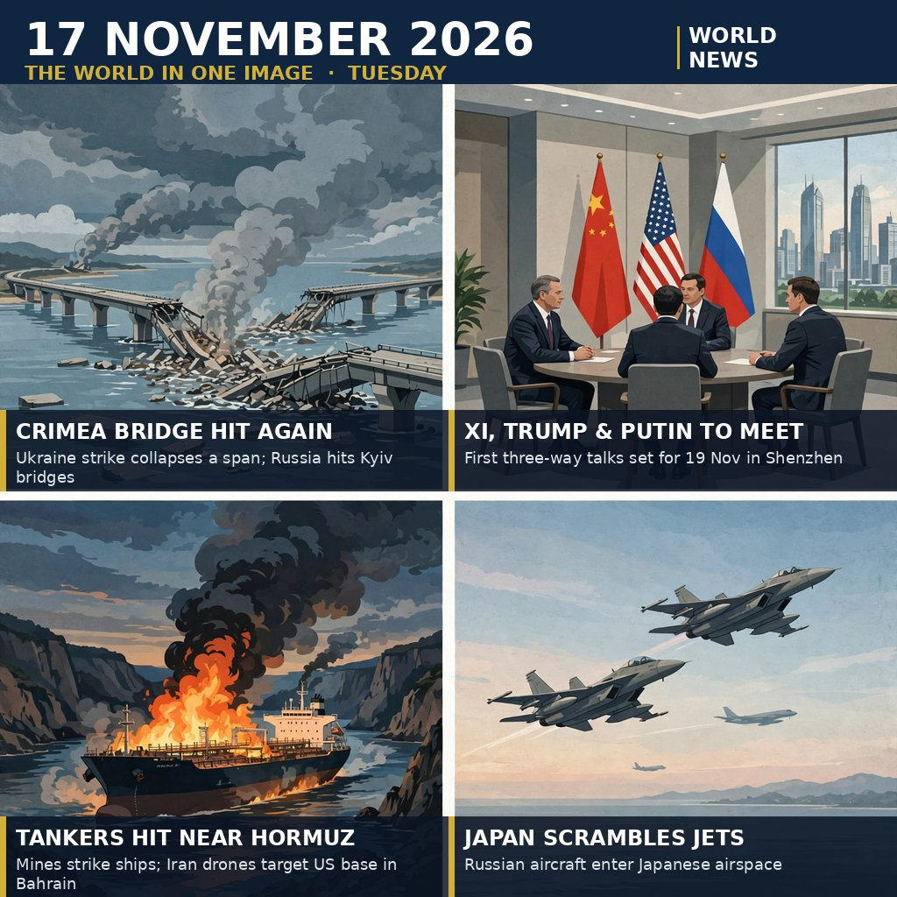

# 17 November 2026 — The World in One Image

[](https://make.fun/c/news-image-20261117)
[](https://make.fun/c/news-image-20261117)
[](https://make.fun/c/news-image-20261117)

One image summing up Tuesday 17 November 2026's world news, built for the
[make.fun](https://make.fun/c/news-image-20261117) competition
`news-image-20261117`.



## The four stories in the picture

1. **Crimea Bridge hit again** — Ukraine struck the bridge linking Russia to
   occupied Crimea for a second day, collapsing a span; Russia hit Kyiv's
   bridges over the Dnipro, disrupting heating, water and power.
2. **Xi, Trump & Putin to meet** — China confirmed the first three-way meeting
   of the three leaders, set for Thursday 19 November in Shenzhen on the
   sidelines of the APEC leaders' meeting.
3. **Tankers hit near Hormuz** — Tankers struck mines near the Strait of
   Hormuz and caught fire; Iran fired drones at a US military radar system in
   Bahrain, which Bahrain said it intercepted with no casualties.
4. **Japan scrambles jets** — Japan launched fighter jets and protested after
   suspected Russian aircraft violated its airspace early in the morning.

The artwork is an original illustration generated for this entry; the date
header and headline labels were added with Pillow. No press photographs were
used.

## How it runs

`main.ts` (Node 22, standard library only) copies `entry.png` to
`$MAKEFUN_OUTPUT_DIR` (default `/output`), verifies it is a whole PNG or
JPEG under 1 MiB, and writes nothing else. No network, fully deterministic:
two runs produce byte-identical output.

```sh
mkdir -p out && MAKEFUN_OUTPUT_DIR=out node main.ts
```

Built with [make.fun](https://make.fun/r/wxz47nrz)
